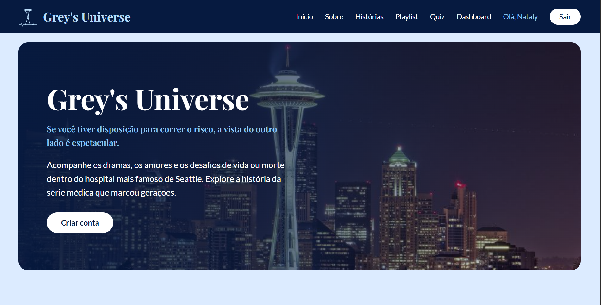
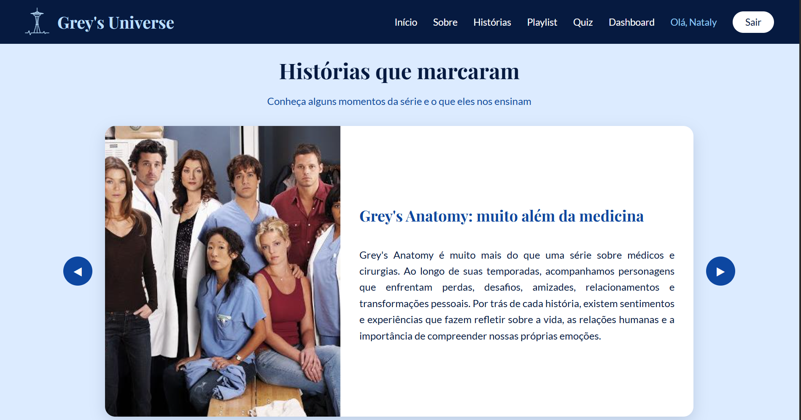
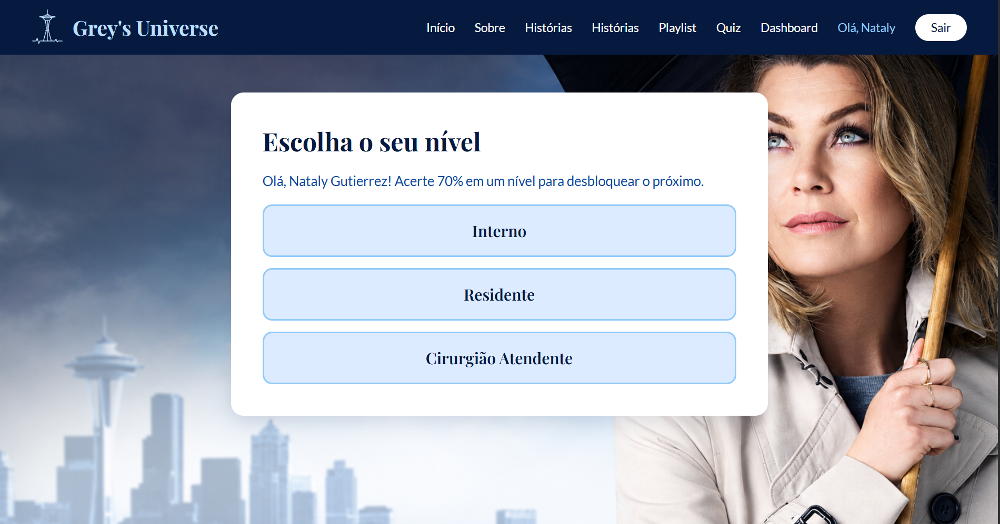
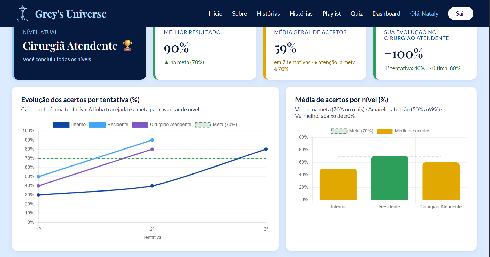
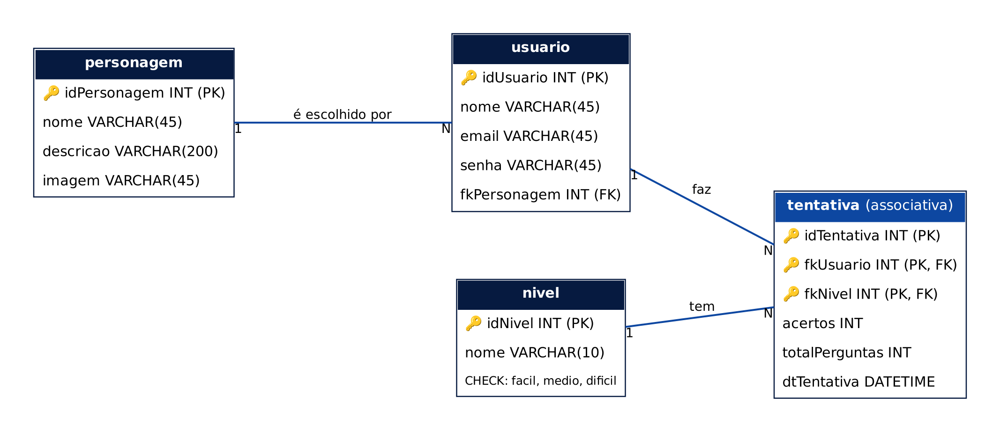

# Grey's Universe 🗼

Site interativo sobre a série **Grey's Anatomy**, feito para dois públicos: quem nunca assistiu e quer conhecer a série, e quem já é fã e quer testar o quanto sabe.



Projeto Individual do 1º semestre de Análise e Desenvolvimento de Sistemas, **SPTech** (turma 1ADSA, 2026).
Autora: **Nataly Rufino Pereira Gutierrez**

## O que o site faz

- **Home:** sobre a série, personagens, carrossel com histórias marcantes, playlist e convite para o quiz
- **Cadastro e login** com validações em JavaScript
- **Escolha de personagem** para o perfil
- **Quiz** com 3 níveis (Interno, Residente e Cirurgião Atendente), 10 perguntas cada, correção a cada pergunta e liberação do próximo nível com 70% de acertos
- **Dashboard** com o personagem escolhido, 4 KPIs, semáforo de cores e gráficos de evolução e de média por nível

## Telas

| Histórias que marcaram | Quiz |
|---|---|
|  |  |

| Dashboard: Seu Prontuário de Desempenho |
|---|
|  |

## Tecnologias

| Parte | Tecnologia |
|---|---|
| Front-end | HTML, CSS e JavaScript |
| Gráficos | Chart.js |
| Back-end | Node.js + Express (base: API [web-data-viz](https://github.com/BandTec/web-data-viz) da SPTech) |
| Banco de dados | MySQL em uma VM Linux (Lubuntu no VirtualBox) |

## Estrutura de pastas

```
greys-universe/
├── api/      → API Node.js (routes → controllers → models → database)
├── banco/    → script SQL de criação do banco
├── docs/     → documentação e Diário de Prompts
└── front/    → páginas HTML, CSS e imagens
```

## Como rodar

1. Ligue a VM com o MySQL e rode o script `banco/script-greys-universe.sql`.
2. Na pasta `api`, crie o arquivo `.env.dev` com os dados de conexão do banco (ele não vai para o Git por conter senha).
3. Instale as dependências e inicie a API:
   ```
   cd api
   npm install
   node app.js
   ```
4. Abra `http://localhost:3333` no navegador.

## Banco de dados



4 tabelas: `personagem`, `usuario`, `nivel` e `tentativa` (tabela associativa do relacionamento N:N entre usuário e nível).

## Documentação

- [Documentação do projeto](docs/documentacaoGreysUniverse.docx)
- [Diário de Prompts](docs/diario-de-prompts.md)
- [Quadro no Trello](https://trello.com/b/fUpWmD50/projeto-individual-greys-universe)
